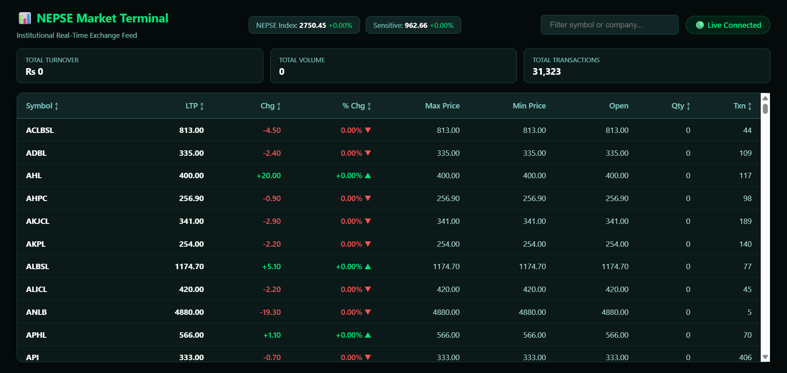
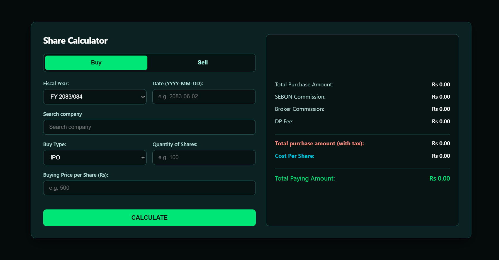
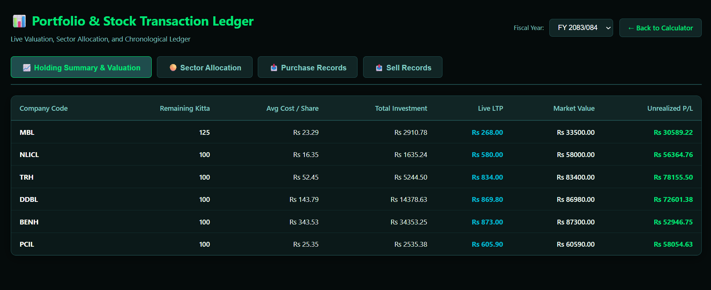
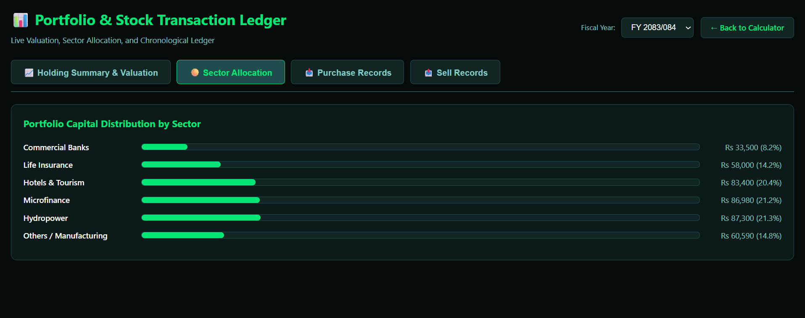
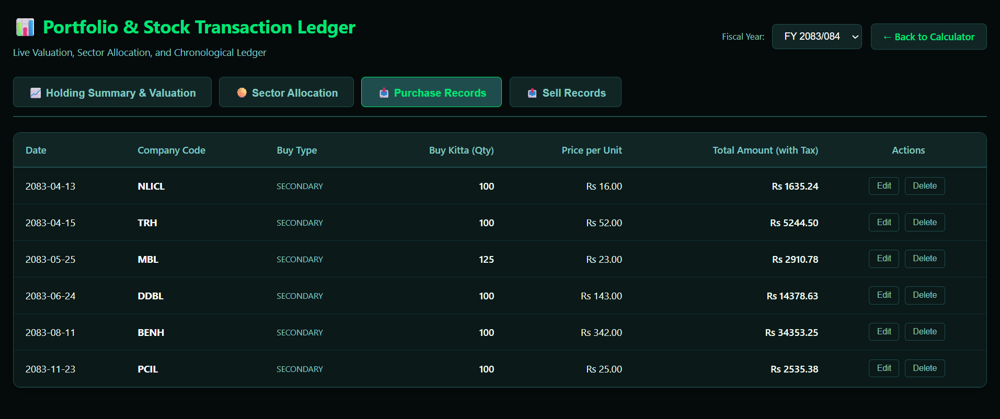

# 📊 NEPSE Market Terminal, Share Calculator & Portfolio Ledger

A clean, institutional-grade web application built for tracking Nepal Stock Exchange (NEPSE) live data, calculating exact buy/sell transaction fees, and managing multi-fiscal-year portfolio ledgers with real-time valuation and sector allocation.

---

## 📷 Application Previews

### 1. Live Market Terminal


### 2. Share Calculator


### 3. Holding Summary & Live Valuation


### 4. Sector Allocation Distribution


### 5. Chronological Purchase & Sell Records


---

## ✨ Core Features
* **Institutional Real-Time Terminal:** Live market feed displaying LTP, point changes, percentage change, open/max/min prices, and trading volumes.
* **Smart Fee Engine:** Automatically applies regulatory deductions (Broker fees, SEBON, DP fee, and CGT brackets).
* **Tabbed Portfolio Ledger:** Clean separation between Holding Valuations, Sector Allocation Bars, Purchase Records, and Sell Records.
* **Chronological Sorting:** Automatically sorts transaction ledgers sequentially by date.
* **Fiscal Year Separation:** Isolates local data storage by Nepalese Fiscal Years (e.g., `FY 2083/084`).
* **Privacy & Local Storage:** Runs completely client-side using browser `localStorage` with no external database dependency.

---

## 🚀 Getting Started Locally
1. Clone the repository:
   ```bash
   git clone [https://github.com/Sushreet-o/nepse-terminal.git](https://github.com/Sushreet-o/nepse-terminal.git)
